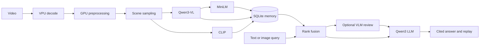

# EdgeMemory

**On-device multimodal video intelligence and semantic memory for Qualcomm Dragonwing.**

Video search · Image-to-video retrieval · Evidence-grounded Q&A · Local video RAG

EdgeMemory transforms video into timestamped, searchable evidence on a resource-constrained edge SoC. It combines hardware video processing, two resident 4B generative models, cross-modal embeddings, and a local web workbench. No cloud inference is required for the validated device path.

[中文介绍](README.zh-CN.md) · [Quickstart](docs/QUICKSTART.md) · [Architecture](docs/ARCHITECTURE.md) · [Benchmarks](benchmarks/README.md) · [Contributing](CONTRIBUTING.md)

## Highlights

- Qualcomm VPU H.264 decode and QIM/GLES GPU preprocessing, with stride-aware frame sampling.
- Qwen3-VL-4B for event captions and evidence review; independent Qwen3-4B for cited answers.
- CLIP 512D visual memory and MiniLM 384D text memory, fused by rank with timestamp filters.
- Persistent model workers, bounded admission, shared HTP locking, and CPU fallback.
- Device-hosted web workbench for upload, timeline, search, review and video replay.

## Device results

| Workload | IQ-9075 observation |
| --- | ---: |
| Long-video duration | 734.167 s |
| End-to-end indexing | 967.759 s (0.759× real time) |
| Indexed events / failed events | 196 / 0 |
| Completed VLM captions / CLIP vectors | 195 / 196 |
| Single 4B LLM evidence Q&A | 3.498 s |
| TTFT / prefill / decode | 723 ms / 369.76 / 15.96 tokens/s |

The last row reports TTFT in milliseconds and throughput in tokens/s. The LLM request is a separate experiment, not an average during indexing. Index completion is not retrieval or caption accuracy. See the [measurement notes](benchmarks/README.md).

## Architecture



| Resource | Role |
| --- | --- |
| VPU | GStreamer V4L2 H.264 decode |
| Adreno GPU | QIM GLES scaling and color conversion |
| Hexagon HTP | GenieX VLM and LLM |
| ARM CPU | CLIP, MiniLM, SQLite, sampling and fallback |

HTP0 and HTP4 are logical selectors, not proof of physically independent execution. DMA-BUF is observed in the video path; JPEG preparation still maps selected frames.

## Get started

For a host-side workbench with separately running local model endpoints, see the [quickstart](docs/QUICKSTART.md). For deployment on a compatible IQ-9075 device, the guide covers the validated software versions, external assets and QDC connection profile. No SDKs or model weights are bundled.

Native development and tests:

```sh
cmake --preset wsl-gcc
cmake --build --preset wsl-gcc
ctest --preset wsl-gcc
```

Windows users may substitute the `windows-msvc` preset. Host tests exercise control flow, not accelerator performance.

## Source map

| Path | Responsibility |
| --- | --- |
| `edgememory/` | Ingestion, model adapters, memory, retrieval, web/API |
| `src/`, `include/` | C++20 runtime and native backend adapters |
| `tools/remote/` | Target-side video sampling and asset helpers |
| `tools/qdc_device.py` | Deployment and collection |
| `configs/` | Model manifests and example configuration |
| `tests/` | Host regression tests |

## Scope

This is an engineering preview of local video memory, not a production NVR or a validated safety-critical detector. CPU CLIP, exact-search scaling, fresh-session restoration, browser acceptance, sustained concurrency and automatic recovery remain areas for further work.

Inspired by [NVIDIA VSS](https://docs.nvidia.com/vss/latest/index.html); independently developed, not an official NVIDIA or Qualcomm product.

## License

[MIT](LICENSE) for project-authored code. External SDKs, runtimes, models and media retain their own terms. See [third-party notices](THIRD_PARTY_NOTICES.md).
